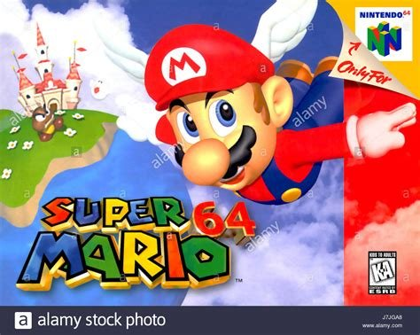
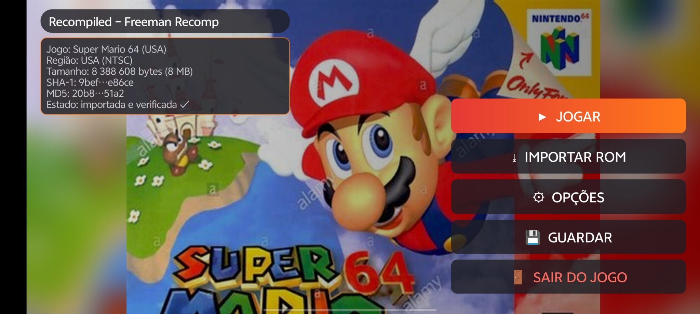
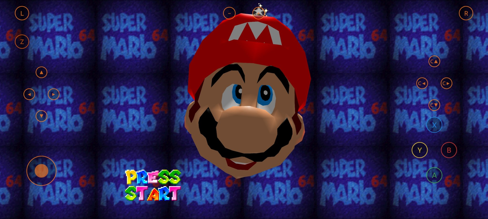

# Super Mario 64: Recompiled — Android (Freeman Recomp)


> 🇵🇹 Nota: projeto pessoal, em português de Portugal. O jogo é o Super Mario 64 (USA) a correr de forma nativa no Android, com controlos de toque estilo Nintendo Switch.



## What it is

A native Android port of **Super Mario 64 (USA)** built with the N64Recomp static recompilation toolchain ([n64hub/super-mario-64-recomp](https://github.com/n64hub/super-mario-64-recomp) v0.1.8) — N64Recomp + N64ModernRuntime + RT64 (Vulkan). No emulation: the game's own code runs natively on ARM64, with a custom Java launcher and Switch-style touch controls.

This repository is a **snapshot of the v12 build state** — the upstream submodules are inlined with the Android changes already applied (see `runtime-patches/` for the record of what changed). There is no ROM and no game data in this repo.

## Features (v12)

- **Native performance** — RT64 / Vulkan renderer, MSAA 4x, up to 240 FPS cap
- **Switch-style touch controls** — analog stick, A/B/X/Y diamond (A right, B bottom), L/R/Z, START/SELECT
- **Camera stick** — a second, smaller stick above the A/B/X/Y diamond that drives the N64 C-buttons (move the camera, release to stop)
- **One-screen Options** — graphics, sound and controls, all on a single screen, no scrolling
- **Fast startup** — under half a second of window wait (was 2 s)
- **No error popups** — diagnostics are written to files only, never shown on screen
- **ROM import in the app** — your own USA ROM is validated (SHA-1 + MD5 + size) and stored privately
- **Saves kept** — installing a new version over the old one keeps your saves and your imported ROM

## Screenshots

| Launcher | Gameplay |
|---|---|
|  |  |

## Requirements

- Android 7.0+ (API 24), ARM64 (arm64-v8a) — tested on iQOO Neo 5 (Snapdragon 870, Adreno 650)
- **Your own legal copy of Super Mario 64 (USA)** — the ROM is **not** included in this repo or in the APK. The app only accepts the USA release:
  - SHA-1: `9bef1128717f958171a4afac3ed78ee2bb4e86ce`
  - Size: 8,388,608 bytes

## Install

1. Download the APK from [**Releases**](../../releases) (v12).
2. Install it on your phone (allow installs from unknown sources once).
3. Open the app, tap **IMPORTAR ROM**, pick your `Super Mario 64 (USA).z64`.
4. Tap **JOGAR**.

## Build from source

You need your own legal USA ROM to build — N64Recomp generates the game's code from it at build time. Place it at `roms/sm64.us.z64` (gitignored, never committed).

Prerequisites (Linux x86_64 host): Android SDK (platform 36, build-tools 36), NDK 28.2, CMake 3.22+, Ninja, JDK 17.

```bash
# 1. Native library (RT64 + recompiled game)
cmake -B build-android -S . -DCMAKE_TOOLCHAIN_FILE=$ANDROID_NDK/build/cmake/android.toolchain.cmake \
  -DANDROID_ABI=arm64-v8a -DANDROID_PLATFORM=android-24
cmake --build build-android --target libmain.so

# 2. Android app (Gradle project in android/)
cd android && ./gradlew assembleDebug
# ...then zipalign + apksigner with your own keystore
```

Full build record for v12: [`docs/BUILD-v12-notes.md`](docs/BUILD-v12-notes.md).

## Controls

| Touch | Action |
|---|---|
| Left stick | Move Mario |
| A (green, right) | Jump |
| B (red, bottom) | Punch / pick up |
| X / Y | Crawl / ground-pound context actions |
| Camera stick (above A/B/X/Y) | Move the camera (N64 C-buttons) |
| L / R / Z | Camera / crouch / ground-pound |
| START (+) | Pause · SELECT (−) | In-game menu |

## Credits

- Upstream: [n64hub/super-mario-64-recomp](https://github.com/n64hub/super-mario-64-recomp) (N64Recomp, N64ModernRuntime, RT64, RecompFrontend)
- Model for the Android adaptation: [BanjoRecomp-Android](https://github.com/AurelioB/BanjoRecomp-Android)
- This port: Freeman Recomp — personal, non-commercial, for my own legal copy only.

## License

GPL-3.0 (`COPYING`), as the recompilations it follows. The decomp in `lib/sm64` is its own project, under CC0. `lib/xbrz` is xBRZ 1.9 by Zenju, GPL-3.0 with its own exception (`lib/xbrz/License.txt`).
